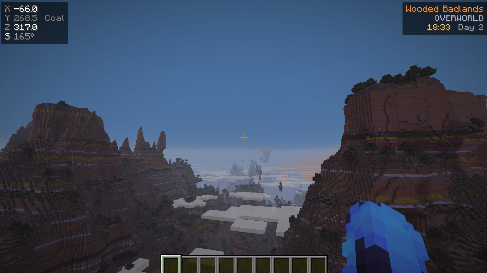
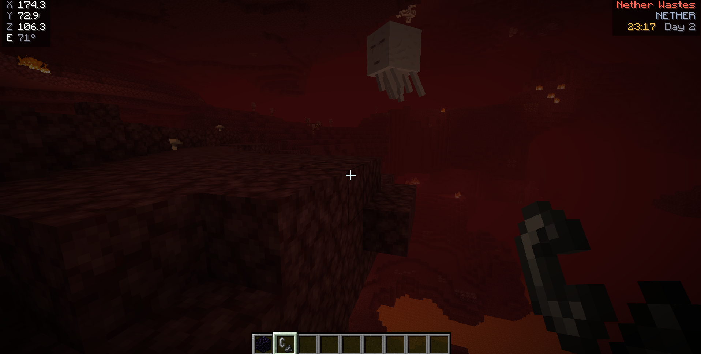
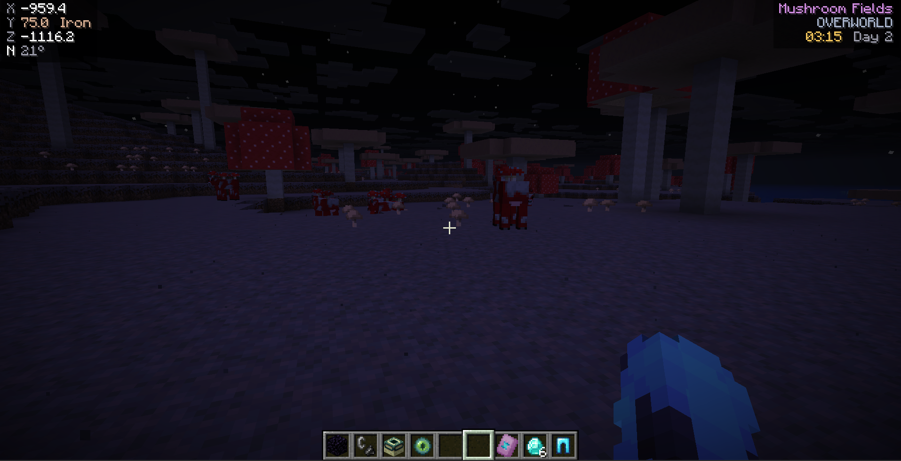
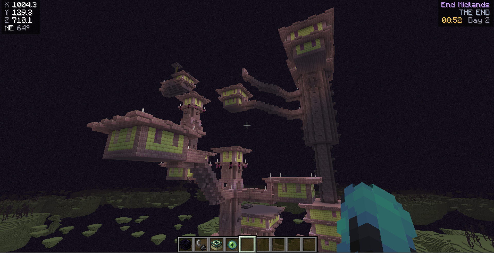
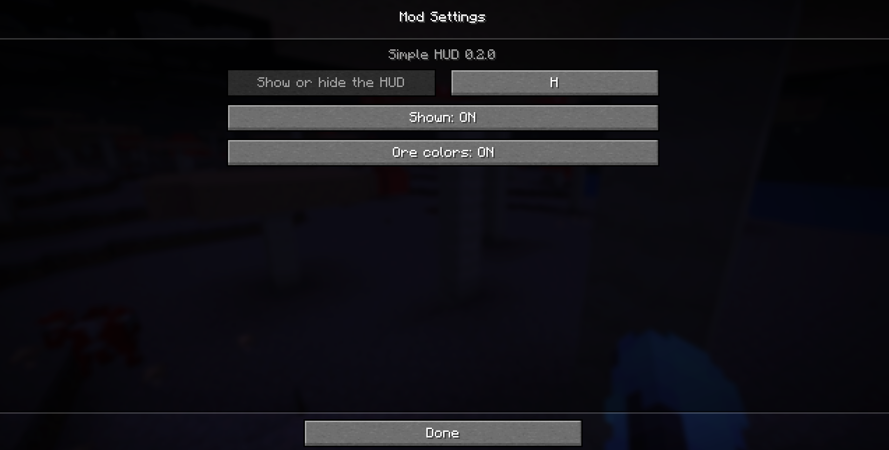

# Simple HUD

A small, clean replacement for F3 in Minecraft: your coordinates, the direction you're facing, the biome, the dimension and the time, in two quiet boxes in the top corners of the screen. Nothing else.

Simple HUD is a native mod for [Horizon](https://github.com/horizon-rust/horizon), the Rust reimplementation of Minecraft Java. It is a few hundred lines of Rust that draw a handful of text lines, so it costs next to nothing to run.



## Why

The F3 screen is made for debugging, and most of it means nothing to a normal player. If you only want to know where you are, which way you're facing and what time it is, Simple HUD shows exactly that and gets out of the way.

- **Coordinates and facing:** X, Y, Z to one decimal, plus a compass bearing (`S 165°`).
- **Biome, dimension and time:** the biome is coloured by its kind, followed by `OVERWORLD`, `NETHER` or `THE END`, then the in-game clock and day number.
- **Ore colours (optional):** in the Overworld the Y line is coloured by the ore that is most common at your height (Coal, Iron, Gold, Lapis, Redstone). At diamond depth all three coordinates turn cyan.
- **Light on resources:** no per-frame world scans or background threads. It only draws a few text lines and reads the biome at your feet.
- **Customizable:** toggle it with a key, a command or the settings page, and rebind the key.

## Screenshots

| Nether Wastes | Mushroom Fields |
| --- | --- |
|  |  |

| End Midlands | Settings |
| --- | --- |
|  |  |

## Usage

| Action | How |
| --- | --- |
| Show or hide the HUD | Press `H` (rebindable in **Options > Mods**) or run `/hud` |
| Put your position in chat | Run `/where`, for example `12, 70, -4 in minecraft:the_nether` |
| Change settings | **Options > Mods > Simple HUD** |

The key only works while you are playing, so typing `h` in chat or on a sign won't toggle the HUD. Your choices are saved between sessions.

### Settings

| Setting | Default | What it does |
| --- | --- | --- |
| Shown | ON | Shows or hides the HUD (same as `H` and `/hud`) |
| Ore colors | ON | Colours the Y line by ore band in the Overworld |

## Install

Simple HUD is built by the Horizon launcher as a native mod (see [`mixins/simple_hud/horizon-mixin.toml`](mixins/simple_hud/horizon-mixin.toml)). It uses only Horizon's native hook points, so it should build on any Horizon revision that has them.

Tested on Minecraft `26.3` with Horizon revision `c9d474d` (see [`compatibility.json`](compatibility.json)).

The biome lookup follows Horizon's own fields, the same way its F3 screen does, because there is no hook point for it. A Horizon update that renames those fields may need a small change here.

## Development

The mod's logic (ore bands, biome colours, bearing, clock) is plain Rust and is also the crate's library, so its tests run without the game:

```sh
cargo test
```

```
mixins/simple_hud/
  runtime.rs          logic and tests
  hud.rs              draws the two boxes
  command.rs          /hud and /where
  key.rs              toggle key
  settings.rs, click.rs, list.rs   Options > Mods page
  horizon-mixin.toml  hook points
```

## License

[MIT](LICENSE)
